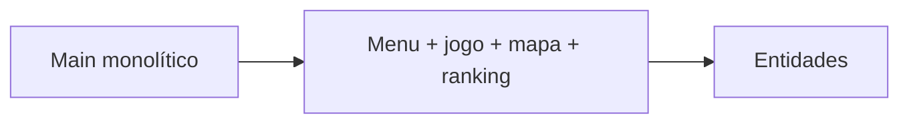
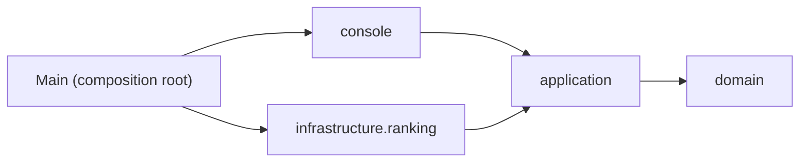
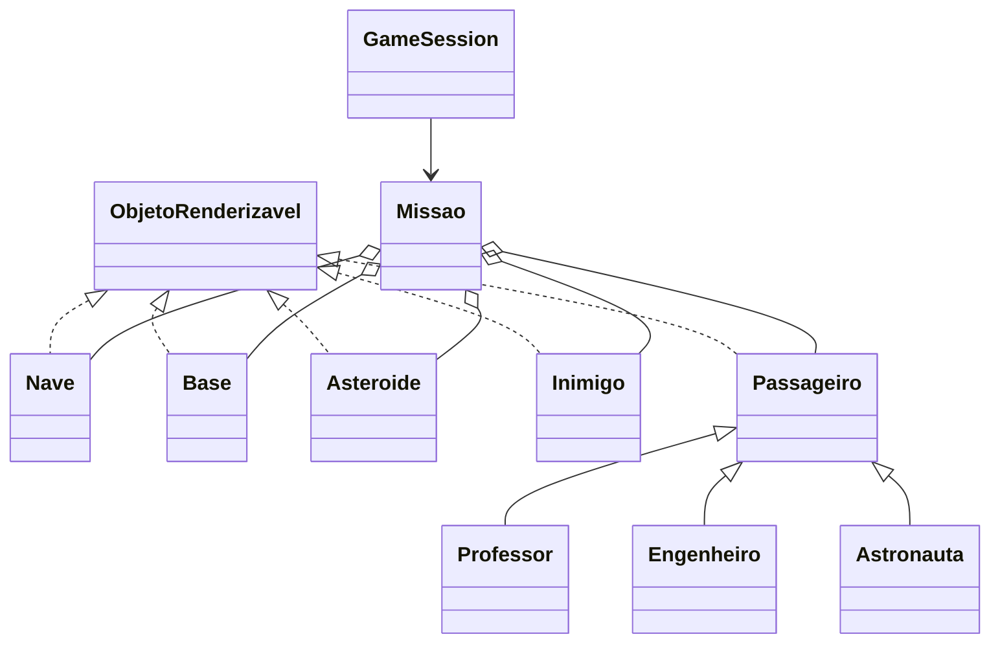

# Fase 1 — Refatoração arquitetural

## Objetivo e ponto de partida

A versão inicial em `fase-0/src/Main.java` concentrava menu, leitura do teclado, cenário, regras, desenho do mapa e gravação do ranking. As entidades tinham estado mutável exposto por getters e a apresentação reconhecia passageiros com testes por subtipo. A implementação desta fase foi escrita separadamente para o Grupo 07; o código de referência foi usado para compreender o jogo, não como fonte para copiar.

## O que mudou

1. As entidades e posições foram organizadas em `domain`.
2. `MissaoFactory` passou a criar cenários e impedir posições iniciais repetidas.
3. `GameSession` coordena turnos, embarque, colisões, entrega, pontuação e fim de partida.
4. `ConsoleGame` traduz a interação textual e `ConsoleRenderer` desenha os objetos por meio de posição e símbolo fornecidos pelo próprio domínio.
5. `RankingService` aplica o limite e a ordenação; `RankingRepository` é a porta e `FileRankingRepository` persiste JSON.
6. `Main` ficou como composition root e `build.ps1` compila com Java 17.

### Correções após o teste manual

- O menu e a tela da partida agora são impressos antes de qualquer chamada bloqueante a `Scanner.hasNextLine()`. Assim, o menu aparece ao iniciar; depois de cada turno, o mapa/indicadores aparecem antes de pedir o próximo comando.
- A dificuldade é convertida com `Dificuldade.tentarInterpretar`. Entrada desconhecida não seleciona um nível silenciosamente: uma mensagem mostra as opções e a pergunta se repete.
- O movimento informa a nova coordenada. Ao atingir a borda, a posição mantida é explicada em vez de parecer que a tecla foi ignorada.
- O passageiro mantém sua posição durante o embarque e o inimigo não pode ocupar uma célula com passageiro, evitando que o símbolo do inimigo o encubra. O embarque sem passageiro também informa a coordenada verificada.
- Ao abortar ou encerrar a entrada durante uma partida, o jogo informa o retorno ao menu; o menu é redesenhado antes de solicitar outra opção.

| Responsabilidade | Antes | Agora |
|---|---|---|
| Fluxo/menu e entrada | Métodos estáticos em `Main` | `console.ConsoleGame` |
| Turno e regras | Loop de `Main` | `application.GameSession.processar` |
| Configuração do cenário | `Main.criarNovaMissao` | `application.MissaoFactory.criar` |
| Entidades e posição | Classes do pacote padrão | `domain` |
| Mapa/legenda | Símbolos e verificações no loop de desenho | `ConsoleRenderer`, `ObjetoRenderizavel` |
| Ranking | Acesso direto ao arquivo e ordenação em `Main` | `RankingService` e `RankingRepository` |
| Inicialização | `Main` misturava configuração e jogo | `Main` instancia dependências |

## Comparação com a implementação do professor

A versão do professor em `exercicio10/fases/fase-01-refatoracao` tem 26 fontes Java e uma decomposição mais granular. A nossa tem 24 fontes Java. Não copiamos os fontes: reorganizamos as responsabilidades com outros contratos e preservamos algumas regras do jogo de partida.

| Tema | Professor | Grupo 07 | Decisão e vantagem |
|---|---|---|---|
| Configuração de dificuldade | `ConfiguracaoDificuldade` e `RegrasDificuldade` separam os parâmetros do enum. | Os números ficam nos campos de `Dificuldade`. | Menos classes e consulta direta à configuração; em contrapartida, acrescentar uma dificuldade exige editar o enum. |
| Perigos | `Perigo` fornece um contrato comum para asteroide e inimigo. | `Asteroide` e `Inimigo` implementam `ObjetoRenderizavel`; `Missao` verifica cada coleção. | Reaproveitamos o contrato que o renderizador já precisa; perdemos a abstração comum para colisão e extensão de perigos. |
| Ranking | `RankingRepository` e `RankingEntry` ficam em `infrastructure`; a lógica de fluxo/ranking permanece ligada à aplicação de console. | A porta e a entrada ficam em `application.ranking`, com `RankingService`; o arquivo é apenas o adaptador. | A regra pode ser reutilizada pela futura interface gráfica sem depender de infraestrutura. Antecipamos a mudança que a Fase 3 pede. |
| Quantidades e pontos | Fácil: 4 passageiros/4 asteroides/1 inimigo, 100 pontos; médio: 6/8/3, 70; difícil: 8/12/5, 45. | Fácil: 4/1/1, 30 pontos; médio: 5/2/2, 20; difícil: 5/3/3, 45. | Optamos por manter quantidades e pontuação do código inicial da atividade, em vez da configuração mais exigente da refatoração do professor. Isso reduz a quantidade de entidades e o esforço de uma partida, mas muda o balanceamento e não é equivalência funcional com a Fase 1 do professor. |
| Posições iniciais | `Missao` cria a base em `(0,0)` e `MissaoFactory` cria a nave também em `(0,0)`; a fábrica reserva essa coordenada para os demais objetos. | A base fica em `(0,0)` e a nave começa em `(0,1)`; a fábrica reserva ambas. | Corrige a sobreposição inicial entre nave e base e deixa a base alcançável por um movimento. |
| Colisão | `GameSession` remove os perigos na célula atingida e desconta 5 pontos por perigo removido. | A sessão desconta 5 pontos e uma vida, mas mantém asteroides e inimigos na missão. | Mantém os elementos e suas posições simples; a contrapartida é que um perigo pode causar nova colisão se a nave continuar na célula. |
| Sorteio do cenário | A fábrica encerra após um número máximo de tentativas e informa se não encontrou posição. | `posicaoLivre` repete o sorteio até obter uma posição inédita. | Implementação curta para o mapa fixo atual (25 células e até 13 objetos); para mapas/configurações extensíveis, o limite explícito da solução do professor é mais seguro contra saturação. |
| Responsabilidades de domínio | `Missao` usa `Perigo` e agrega os elementos renderizáveis. | `Missao` mantém listas tipadas de perigos e passageiros e monta a lista renderizável quando solicitada. | As listas tipadas preservam acesso simples aos elementos usados pelas regras; o custo é reconstruir a visão renderizável ao desenhar. |

## Regras e escolhas

- A capacidade é igual ao total de passageiros da dificuldade.
- Base em `(0,0)` e nave em `(0,1)`: evita sobreposição no estado inicial.
- A fábrica reserva as posições da base e da nave e usa um conjunto de coordenadas já ocupadas ao distribuir passageiros e perigos.
- A capacidade da nave corresponde ao total de passageiros da dificuldade. O embarque remove o passageiro do mapa; a entrega na base esvazia a nave e incrementa o total entregue.
- Vitória exige que passageiros entregues sejam iguais ao total da missão, não apenas que todos tenham embarcado. A HUD textual exibe a bordo, entregues e no mapa.
- Mudanças em relação à versão inicial: mapa com raio fixo de cinco, em vez de perguntar o tamanho; símbolos `@`, `L`, `P`, `E`, `T`, `#` e `X`; Top 10 em vez do Top 5 do menu legado; nave inicia adjacente à base; colisão também reduz cinco pontos. A vitória agora exige entregar todos na base (não apenas embarcar).

## SOLID

| Princípio | Onde aparece | Aplicação | Limite atual |
|---|---|---|---|
| SRP | `GameSession`, `ConsoleRenderer`, `FileRankingRepository` | Regras, apresentação do mapa e persistência estão em componentes diferentes. | `ConsoleGame` ainda organiza menu e partida. |
| OCP | `Passageiro` e seus subtipos | Cada tipo define valor e símbolo por polimorfismo; a sessão não verifica o subtipo. | `MissaoFactory` usa seleção por índice para escolher os tipos. |
| LSP | `Professor`, `Engenheiro`, `Astronauta` | Todos atendem ao contrato de passageiro renderizável e podem ocupar a mesma lista. | Há poucos subtipos e o contrato ainda não é exercitado por implementações externas. |
| ISP | `ObjetoRenderizavel` | A interface expõe somente posição e símbolo, necessários ao renderizador. | `RankingRepository` concentra carregar, salvar e limpar; pode ser dividido se surgirem clientes diferentes. |
| DIP | `RankingService` e `RankingRepository` | A regra de ranking depende da abstração; o repositório de arquivo é ligado em `Main`. | `ConsoleGame` recebe o serviço concreto, não uma porta de casos de uso. |

## GRASP

| Padrão | Classe/método | Responsabilidade |
|---|---|---|
| Controller | `GameSession.processar` | Recebe ação e coordena as operações de um turno. |
| Information Expert | `Nave.embarcar` | Conhece capacidade e passageiros a bordo. |
| Information Expert | `Missao.entregarNaBase` | Conhece base, nave e estado dos passageiros. |
| Creator | `MissaoFactory.criar` | Conhece as quantidades e dependências necessárias para montar uma missão. |
| Low Coupling | `RankingService` | Usa a interface do repositório, sem depender de arquivo. |
| High Cohesion | `ConsoleRenderer` | Reúne apenas a construção da representação textual do mapa. |
| Polymorphism | `Passageiro.simbolo` e `valorResgate` | Variações de passageiros são tratadas sem condicionais por tipo na sessão. |
| Pure Fabrication | `RankingService` | Isola política de ranking que não pertence naturalmente a uma entidade. |

## Padrões e diagramas

- **Factory**: `MissaoFactory` cria uma composição de cenário válida; centraliza distribuição aleatória e regras de ocupação.
- **Repository**: `RankingRepository` define operações de ranking e `FileRankingRepository` implementa persistência substituível.
- **Value Object**: `Posicao` é imutável e compara coordenadas por valor.
- `RankingService` recebe o repositório por construtor (injeção de dependência). Não há uma Strategy de dificuldade: os parâmetros são dados do enum, não algoritmos intercambiáveis.

## Limitações conhecidas

1. O leitor JSON é pequeno e atende ao formato produzido localmente; uma biblioteca JSON seria preferível para interoperabilidade.
2. `MissaoFactory` seleciona subtipos por índice; uma lista de fábricas de passageiros permitiria extensão sem alterar o método.
3. `GameSession` coordena muitas regras; serviços menores para pontuação e colisão facilitariam novas mecânicas.
4. O renderizador recalcula os objetos para cada célula; um índice por posição reduziria o custo em mapas maiores.

## Como compilar

Na pasta `fase-1`, `.\build.ps1` compila todos os fontes com `javac --release 17 -encoding UTF-8`; `.\build.ps1 -Run` compila e abre o menu. A compilação foi executada com sucesso. Os testes automatizados das regras e da persistência foram adicionados na Fase 2.

O fluxo interativo foi verificado com uma entrada controlada: o menu apareceu antes de enviar comandos, uma dificuldade inválida foi recusada, um movimento foi refletido antes da leitura seguinte e `Q` retornou ao menu.

## Materiais didáticos e fontes consultadas

**Referências da implementação:** enunciado da Fase 1 (`exercicio10/fases/fase-01-refatoracao/docs/fase-01-enunciado.md`) e código inicial (`exercicio10/fases/fase-0/src/Main.java`).

**Referências consultadas na revisão desta documentação:** `missaoMarteUnifor/grasp/apostilas-grasp/tutorial-grasp-missao-marte.md`, `missaoMarteUnifor/apostilas-gof/factory-method/APOSTILA.md` e `missaoMarteUnifor/apostilas-gof/adapter/APOSTILA.md`, para conferir a terminologia dos padrões citados.
