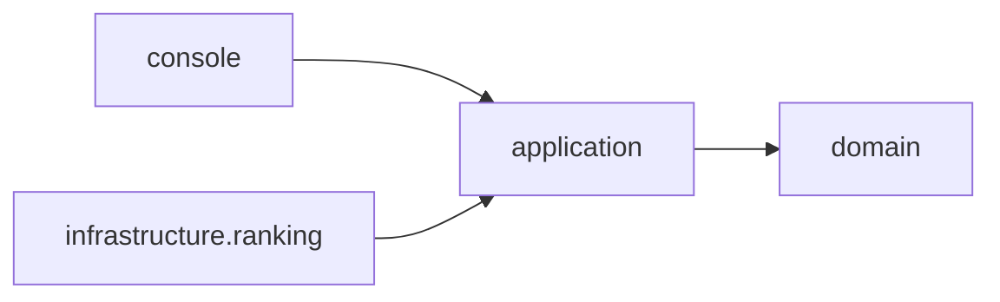
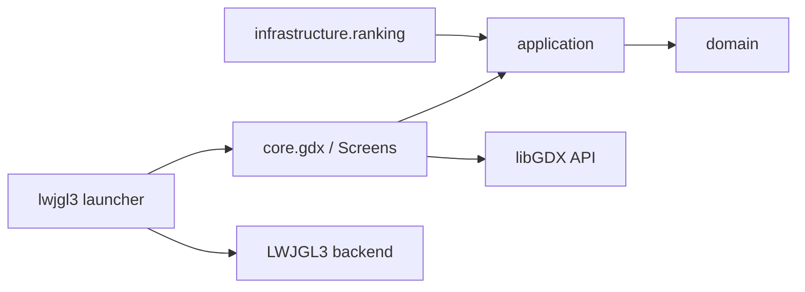

# Fase 3 — Introdução ao libGDX

## De console a aplicação gráfica

A Fase 2 usa aplicação Java de módulo único e entrada pelo terminal. A Fase 3 separa `core` (regras e UI libGDX portável) de `lwjgl3` (launcher desktop). O backend traduz chamadas da API para a plataforma; o core não precisa conhecer o launcher. A versão libGDX está centralizada em `gdxVersion = 1.12.1`.

| Fase 2 | Fase 3 |
|---|---|
| `Main` | `Lwjgl3Launcher` cria as dependências e inicia a janela |
| `ConsoleGame` | `MenuScreen`, `NovaPartidaScreen`, `PartidaScreen`, `RankingScreen` |
| `ConsoleRenderer` | `PartidaScreen` com `ShapeRenderer` e `BitmapFont` |
| Teclas lidas como texto | `TecladoParaAcao` adapta teclas a `Acao` |
| Aplicação módulo único | `core` e `lwjgl3` |





## Conceitos da API presentes

`Game` centraliza os recursos compartilhados e seleciona telas; cada `Screen` tem renderização e entrada próprias. `setScreen` delega o comportamento à tela atual, aproximando o padrão State. `TelaBase` concentra log e ciclo de vida (`show`, `resize`, `pause`, `resume`, `hide`, `dispose`), instala/remove o `InputProcessor` e aplica o viewport.

O jogo cria câmera, `FitViewport(800, 600)`, `SpriteBatch`, `ShapeRenderer` e `BitmapFont` uma vez em `create()`. `FitViewport` mantém a proporção ao redimensionar. Recursos gráficos são liberados por `MissaoMarteGame.dispose()`. A partida atualiza regras apenas ao receber tecla válida, mas desenha o estado em cada `render()`.

`MapaGeometria` converte coordenadas sem depender de libGDX: o eixo y do domínio cresce para baixo, enquanto a tela gráfica cresce para cima. `TecladoParaAcao` converte letras e setas em ações, e tecla não mapeada vira `INVALIDA`, que não consome turno. Os símbolos vêm de `ObjetoRenderizavel`; a nave é adicionada ao fim da lista para ficar sobre outros desenhos.

### Decisões de arquitetura

- As regras, `GameSession` e entidades foram copiadas do código do Grupo 07 da Fase 2 para `core`; fontes comuns de aplicação/domínio/infraestrutura permanecem iguais.
- `RankingRepository`, `RankingEntry` e `RankingService` já estavam em `application.ranking` desde a Fase 1 para respeitar a direção das dependências; por isso não precisaram ser movidos nesta fase. O launcher injeta a implementação em arquivo e o serviço é compartilhado pelas telas.
- `MapaGeometria` é uma fabricação pura para isolar conversão/testes. `TecladoParaAcao` é um adaptador entre códigos de tecla e ações do caso de uso.
- O `lwjgl3` é o composition root: cria fábrica, ranking, `Random`, configura janela 800×600, VSync e 60 FPS. A tarefa `run` usa a raiz da fase como diretório; `-XstartOnFirstThread` é condicional para macOS.

## Testes e evidências

Os 10 testes herdados da Fase 2 exercitam regras e ranking sem abrir janela. `MapaGeometriaTest` cobre eixo x, inversão de y e centro da célula; `TecladoParaAcaoTest` cobre letras, setas, embarque, saída e tecla sem ação. `clean build` com Gradle 9.7.1/Java 25 foi concluído com sucesso, incluindo **12 testes**. Os testes não requerem OpenGL.

O ambiente não tem JDK 17; o wrapper está fixado em Gradle 8.7 e o build foi validado com Gradle 9.7.1 já instalado em cache. A janela não foi executada/inspecionada visualmente nesta validação; portanto, os logs de lifecycle, controles e proporção precisam de conferência manual com JDK 17 e ambiente gráfico. Ao iniciar, cada tela registra os eventos recebidos com `Gdx.app.log`; a ordem efetiva de `pause()`/`dispose()` só é evidenciada ao fechar a janela.

Comandos previstos:

```powershell
.\gradlew --version
.\gradlew clean build
.\gradlew :lwjgl3:run --console=plain
```

## Limitações

1. A interface usa formas e fonte padrão; sprites, animações e som ficam para a Fase 4.
2. O ranking continua persistido em arquivo local e a tela mostra somente texto simples.
3. A seleção de dificuldade usa teclas de função e requer polimento visual/feedback.
4. A conversão de coordenadas e o desenho assumem raio fixo 5; um viewport configurável e layouts responsivos são possíveis em evolução futura.
