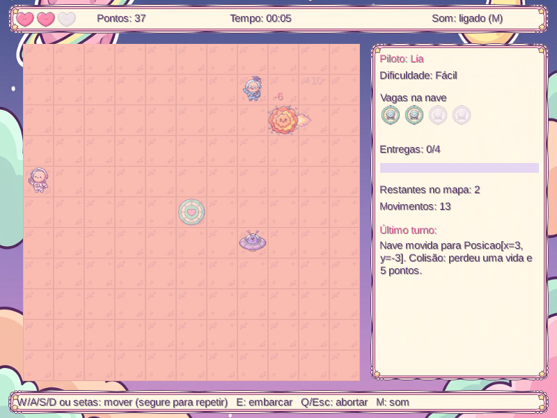

# Fase 4 — Interface gráfica (sprites, HUD, efeitos e sons)

O Missão Marte da Fase 3 ganhou cara de jogo: arte kawaii gerada no Gemini, nave que gira e desliza entre as células, propulsor animado, botões e painéis com moldura, explosão, brilhos, textos flutuantes, tremor, HUD, música e efeitos sonoros. **As regras não mudaram**: o jogo continua por turnos e `domain` é idêntico ao da Fase 3 (conferido por hash).



## 1. Preparar o ambiente

- **JDK 17** em `JAVA_HOME` e no `PATH`.
- Internet na primeira execução (Gradle e dependências).
- Placa de vídeo com OpenGL 2.0+; para ouvir o jogo, um dispositivo de áudio (há opção sem áudio).
- Execute os comandos na raiz de `fase-4`.

```powershell
java -version
.\gradlew.bat --version
```

## 2. Compilar e testar

```powershell
.\gradlew.bat clean build
```

Compila os dois módulos e executa os **43 testes** do `core` (nenhum abre janela, usa OpenGL ou toca áudio). Relatório: `core\build\reports\tests\test\index.html`.

## 3. Jogar

```powershell
.\gradlew.bat :lwjgl3:run --console=plain
```

| Opção | Efeito |
|---|---|
| `-Dmissaomarte.semente=4` | Repete o mesmo cenário e os mesmos movimentos dos inimigos |
| `-Dmissaomarte.semaudio=true` | Desliga o áudio (máquina sem dispositivo de som) |

Exemplo: `.\gradlew.bat :lwjgl3:run -Dmissaomarte.semente=4 --console=plain`. O `ranking.json` é gravado na raiz de `fase-4`.

## 4. Controles

| Tela | Teclado | Mouse |
|---|---|---|
| Menu | `1` jogar, `2` ranking, `3` limpar ranking, `4`/`Esc` sair | clique nos botões |
| Nova partida | digite o nome, `Backspace` apaga, `F1`/`F2`/`F3` dificuldade, `Enter` decola, `Esc` volta | clique na dificuldade, em Decolar ou Voltar |
| Partida | `W/A/S/D` ou setas movem (**segure para repetir**), `E` embarca, `Q`/`Esc` aborta | — |
| Fim de partida | `Enter` (vitória abre o ranking; derrota volta ao menu) | — |
| Ranking | `Enter`/`Esc` volta | botão Voltar |
| Qualquer tela, exceto Nova partida | `M` liga/desliga o som | — |

### Roteiro com vitória (semente 4, Fácil)

Com `-Dmissaomarte.semente=4`, nome qualquer e `F1`, a sequência `S D D D D D E W W W W W A E A W A E A A S S S S W A A A A A E D D D D D S` embarca os quatro passageiros, bate uma vez no asteroide (explosão, tremor, "-6") e termina em vitória com 47 pontos. As capturas em `docs/capturas` foram geradas com esse roteiro.

## 5. Arte e sons

- `tools/arte-gemini/` — arte original gerada no **Google Gemini** (estilo kawaii), reduzida para versionar.
- `tools/MontadorDeAssets.java` — remove o fundo branco, recorta, reduz, monta as faixas animadas, gera os ícones vazios, a variante menta do botão, e **sintetiza os sons** (nenhum áudio de terceiros).

Para remontar `core/assets`:

```powershell
java tools\MontadorDeAssets.java
```

Um teste confere se cada arquivo bate com o catálogo (`Imagem`, `Som`).

## 6. Problemas comuns

- **Janela não abre / tela preta:** confira OpenGL 2.0+ e se o comando foi executado na raiz de `fase-4`.
- **Erro de áudio ao iniciar:** rode com `-Dmissaomarte.semaudio=true`.
- **Teclas não respondem:** dê foco à janela.
- **`M` não silencia:** na tela Nova partida a letra faz parte do nome (é proposital).

Decisões, conceitos, comparação com a referência do professor, evidências e limitações: [docs/tutorial.md](docs/tutorial.md).
