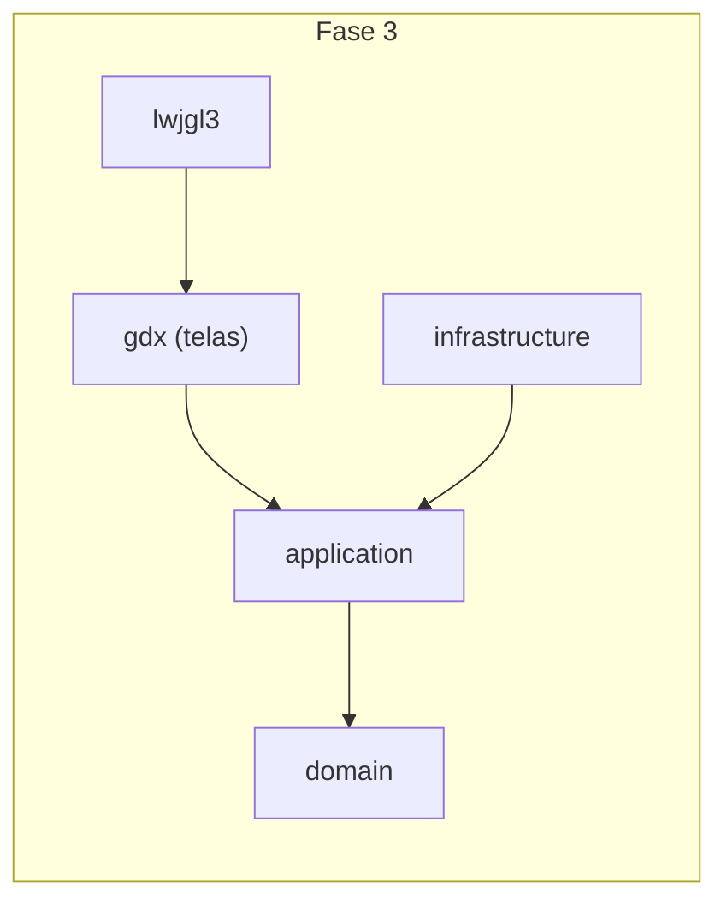
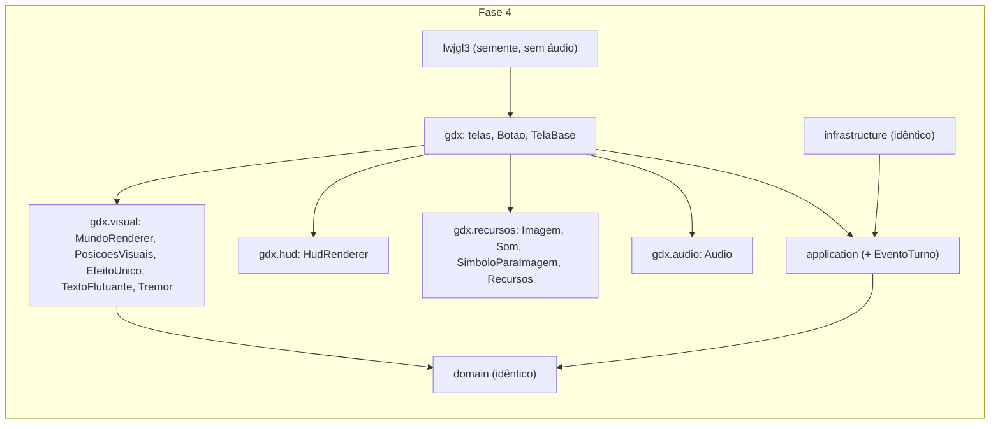

# Fase 4 — Interface gráfica

## 1. Estado de origem e destino

Na Fase 3 a partida era uma grade de retângulos coloridos com letras (`@`, `P`, `#`...), a fonte padrão e um bloco de texto com vidas, pontos e mensagens. Não havia imagem, som, animação nem HUD. Na Fase 4 o mesmo jogo por turnos ganhou arte kawaii, animações, efeitos, sons e HUD, sem mudar nenhuma regra.

| Fase 3 | Fase 4 |
|---|---|
| Retângulo + letra por objeto | Sprite escolhido pelo símbolo (`SimboloParaImagem`) |
| Fundo de cor sólida | `fundo.png` e terreno por célula |
| Nave salta de célula em célula | `PosicoesVisuais` faz o desenho deslizar; a regra continua instantânea |
| Uma tecla = um turno | Mais repetição ao segurar (`RepetidorDeTecla`) |
| Mensagem em texto | `ResultadoTurno` também traz `EventoTurno` (movimento, embarque, entrega, colisão, vitória, derrota) |
| Nenhuma reação à colisão | Explosão, tremor, flash vermelho, nave piscando, "-6" e som |
| Painel de texto | `HudRenderer`: vidas em corações, pontos, tempo, som, vagas em ícones, barra de entregas, mensagens |
| Opções de menu em texto solto | `Botao` com sprite de bala (rosa; menta no destaque) e painéis com moldura (NinePatch), clicáveis com o mouse |
| Sem áudio | Música em laço e um efeito por evento; `M` silencia |
| `PartidaScreen` desenhava tudo | `MundoRenderer` (mapa) e `HudRenderer` (HUD); a tela só orquestra |

A regra de dependência continua: só `gdx` e `lwjgl3` importam `com.badlogic`. As classes de `visual` que fazem contas (`PosicoesVisuais`, `EfeitoUnico`, `TextoFlutuante`, `Tremor`), o `RepetidorDeTecla`, o `Botao` e os catálogos `Imagem`/`Som` também não importam libGDX; por isso são testadas sem janela.

## 2. Conceitos aplicados

**PNG → `Texture` → `TextureRegion` → `Animation`.** O PNG é decodificado e enviado à placa de vídeo como `Texture`. Uma *sprite sheet* é uma imagem com vários quadros lado a lado; em `Recursos`, `TextureRegion.split(textura, larguraQuadro, alturaQuadro)[0]` recorta a faixa em regiões, e `new Animation<>(0.18f, quadros)` as transforma em animação. Base, inimigo e propulsor usam `getKeyFrame(tempo, true)` (laço); explosão e brilho são de uma execução e usam `quadro(imagem, indice)`, com o índice calculado por `EfeitoUnico`.

**`AssetManager`.** `load()` só enfileira; `finishLoading()` carrega de fato. O gerenciador é um campo de `Recursos` (nunca `static`: o contexto OpenGL pode ser recriado, por exemplo no Android, e um estático guardaria texturas mortas). `MissaoMarteGame.create()` cria `Recursos` e `dispose()` libera tudo com `assets.dispose()`; nenhuma tela cria ou libera textura.

**`Sound` x `Music`.** `Sound` é carregado inteiro na memória e serve para efeitos curtos que podem tocar sobrepostos; `Music` é lido em fluxo e serve para a trilha longa em laço. Os dois prendem recursos nativos (OpenAL) e precisam de `dispose()`, feito pelo `AssetManager`. A classe `Audio` só toca e controla o mudo; não carrega nem libera nada.

**Posição visual separada da lógica.** `GameSession` muda a célula da nave de uma vez. `PosicoesVisuais` guarda, por identidade (`IdentityHashMap`), uma posição fracionária de cada objeto que persegue a célula lógica a 12 células/s em linha reta, sem ultrapassar; objetos novos nascem na posição lógica e os que saem do mapa (passageiro embarcado) são esquecidos. A lógica nunca espera o desenho: duas teclas rápidas processam dois turnos. `MapaGeometria` passou a aceitar `float` e converte a coordenada fracionária, mantendo o eixo y invertido.

**HUD desenhado depois do mundo.** O HUD é a camada de informação sobre o jogo; desenhado por último, fica por cima do mapa e não sofre o tremor (a câmera é deslocada só durante o desenho do mundo). `HudRenderer` apenas lê `GameSession` e a `Missao`.

**Por que a colisão não usa `Intersector`.** No referencial, objetos se movem continuamente e a colisão é geométrica (`Circle`, `Rectangle`, `Intersector`). Aqui a colisão é regra do domínio: nave e perigo na **mesma célula** (`Missao.colidiu()`). Usar geometria sobre as posições visuais criaria uma segunda regra, que discordaria da primeira durante o deslizamento. A tela só reage ao evento `COLISAO`.

**Eventos no `ResultadoTurno`.** Antes a tela só tinha texto; reagir a "Colisão" exigiria procurar palavras na mensagem, o que é frágil e coloca regra na tela. `GameSession` agora **registra** em uma lista o que a regra já decidiu, e `PartidaScreen.reagir` traduz eventos em sons e efeitos. Comando inválido e abortar não geram eventos.

## 3. Decisões de projeto

**Origem dos assets.** A arte foi gerada no **Google Gemini** a partir de prompts da equipe (estilo *kawaii*: contorno roxo grosso, tons pastel, carinhas com bochecha rosada). Os prompts pediram fundo branco liso; o `tools/MontadorDeAssets.java` remove esse fundo por preenchimento a partir das bordas (o branco interno, cercado pelo contorno, é preservado), recorta, reduz em etapas com alfa pré-multiplicado (sem halo branco) e monta as faixas. As animações são **derivadas** de uma imagem só (escala, brilho, transparência e rotação), o que mantém o estilo idêntico entre quadros. Os ícones vazios (vida e vaga) são versões acinzentadas, e o botão destacado troca os canais vermelho e verde (rosa vira menta). Os sons foram **sintetizados** pelo mesmo programa. Os originais reduzidos ficam em `tools/arte-gemini/`. Pelos termos do Google, o conteúdo gerado pertence a quem o gerou; registramos aqui que é arte gerada por IA.

**Texturas na camada `gdx`.** As entidades do domínio não guardam `Texture` nem som: isso amarraria as regras ao libGDX, impediria testar sem OpenGL e misturaria aparência com regra.

**Símbolo em vez de `instanceof`.** O domínio já informa `simbolo()` para o console. `SimboloParaImagem` usa esse contrato; um tipo novo só precisa de um símbolo, e símbolo desconhecido usa `desconhecido.png`.

**Atalho de som central.** `TelaBase.show()` monta um `InputMultiplexer`: primeiro o atalho `M`, depois os botões (clique), depois a entrada da tela. Assim o atalho existe uma única vez. `NovaPartidaScreen` devolve `aceitaAtalhoDeSom() = false`, porque `M` faz parte do nome digitado.

**Botões.** O pedido de dar "cara de jogo" ao menu virou um `Botao` (rótulo, retângulo e ação) e o desenho/clique centralizados em `TelaBase`. A tecla e o clique chamam o mesmo método da tela (por exemplo `MenuScreen.novaPartida()`), sem duplicar ação. O clique converte a posição da janela para o mundo 800×600 com `viewport.unproject`, então continua certo ao redimensionar. Esse mesmo caminho servirá para o toque no Android (Fase 6).

**Painéis em NinePatch.** A moldura do Gemini é dividida em nove partes (`new NinePatch(regiao, 52, 52, 52, 52)`): os cantos ficam fixos e só o meio estica, então o mesmo PNG serve para o painel do menu, a barra superior e a caixa de fim de partida.

**Padrões.**
- *Template Method*: `TelaBase.show()` fixa o roteiro (atalho, botões, entrada da tela, `aoMostrar`) e as telas preenchem `criarEntrada()`/`aoMostrar()`.
- *Domain Event* (simplificado): `EventoTurno` comunica fatos do turno; não há barramento nem assinantes, só uma lista devolvida, por isso "parecido com" e não a forma completa.
- *Facade*: `Recursos` esconde `AssetManager`, split de regiões, animações e NinePatch atrás de poucos métodos.
- *Injeção de dependência* (manual): o launcher cria fábrica, ranking, `Random` (com semente) e a flag de áudio e passa ao jogo.
- *Adapter*: `TecladoParaAcao` converte teclas em `Acao`.

## 4. Passo a passo (com os problemas reais)

1. Copiamos `fase-3` para `fase-4` e rodamos `.\gradlew.bat clean build` (17 testes) como base.
2. Criamos `EventoTurno` e o novo componente de `ResultadoTurno`, mantendo o construtor de 3 argumentos; `GameSession` ganhou a lista de eventos e um relógio injetável (`LongSupplier`) para a duração. **Problema:** o teste de eventos não compilou porque `List.of(professores...)` gerava `List<Professor>`, e `Missao` espera `List<Passageiro>`; declaramos o tipo da lista.
3. Criamos o catálogo (`Imagem`, `Som`), `Recursos` e `Audio`. **Problema:** `assets.load(caminho, musica ? Music.class : Sound.class)` não compila (o tipo genérico não fecha); separamos em um `if`.
4. Geramos a arte no Gemini, um prompt por elemento, sempre pedindo "mesmo estilo" e fundo branco. **Problema:** o download do Gemini chega à pasta Downloads como `.tmp` sem nome; nosso script de coleta pegou um arquivo errado da pasta e os nomes ficaram deslocados em uma posição. Fizemos uma folha de contato, renomeamos pelo conteúdo e restringimos o script a arquivos novos de imagem.
5. Escrevemos o `MontadorDeAssets`. **Problemas:** (a) o terreno do Gemini era detalhado demais e sem divisão visível entre 121 células; misturamos 80% com a cor média e escurecemos 1 px de borda. (b) O tile tinha cantos arredondados brancos; cortamos 1/9 da borda. (c) O propulsor, desenhado no mesmo quadrado da nave, ficava escondido atrás dela; passou a ser desenhado recuado e girado em torno do centro da célula.
6. `MundoRenderer`, `HudRenderer`, efeitos, tremor e repetição. A tela ficou só com orquestração (`jogar`, `reagir`, `render`).
7. Depois de ver as primeiras capturas, as opções do menu em texto solto ficaram feias; geramos no Gemini um botão e uma moldura de painel, e criamos `Botao` + NinePatch.
8. **Problema (achado na Fase 5, corrigido aqui também):** ao apertar `1` no menu, o caractere `'1'` chegava à tela Nova partida depois da troca de tela e entrava no nome. `NovaPartidaScreen` ignora a digitação até desenhar o primeiro quadro.
9. Para conferir a janela sem jogar à mão, usamos um roteiro local que envia teclas ao jogo com semente 4 e salva PNGs do *framebuffer* (`docs/capturas`). **Problema:** em duas execuções a janela foi minimizada e as capturas saíram 0×0; deixamos a janela de captura sempre no topo e restaurada.

## 5. Testes e evidências

`.\gradlew.bat clean build` → **BUILD SUCCESSFUL, 43 testes, 0 falhas** (validado com Temurin 17.0.21 e Gradle 9.7.1 do wrapper).

| Classe de teste | O que cobre |
|---|---|
| 11 classes herdadas da Fase 3 (17 testes) | Regras, dificuldade, ranking, persistência, teclado e geometria — sem alteração |
| `GameSessionEventosTest` | Cada evento; movimento barrado no limite sem `MOVIMENTO`; inválido e abortar sem eventos; construtor antigo; duração parada após o fim (relógio falso) |
| `RecursosCatalogoTest` | Cada PNG existe com largura = quadro × quantidade e altura certa; cada som é áudio válido; uma única música; símbolo → imagem, inclusive o genérico |
| `VisualTest` | Objeto novo não desliza; persegue sem ultrapassar; linha reta na diagonal; identidade e esquecimento; quadros do efeito e remoção; texto sobe e some; "-1" não aparece; tremor decai até zero |
| `RepetidorDeTeclaTest` | Atraso, intervalo, no máximo uma repetição por chamada, reinício após soltar, ação que não é movimento |
| `MapaGeometriaTest` | + coordenadas fracionárias |
| `BotaoTest` | Área de clique (bordas incluídas) e execução da ação |

**Capturas** (semente 4, roteiro do README): [menu](capturas/01-menu.png), [nova partida](capturas/02-nova-partida.png), [partida](capturas/03-partida.png), [deslizando](capturas/04-deslizando.png), [embarque](capturas/05-embarque.png), [colisão](capturas/06-colisao.png), [entrega](capturas/07-entrega.png), [vitória](capturas/08-vitoria.png), [ranking](capturas/09-ranking.png), [menu de volta](capturas/10-menu-volta.png). O ranking mostra o mesmo tempo da caixa de vitória (a duração para ao terminar). O log da execução mostrou `[Recursos] 20 imagens e 8 sons carregados` e nenhuma exceção.

**Sequência de eventos com semente 4** (mesma rota): `EMBARQUE` (+15) → `EMBARQUE` (+10) → `MOVIMENTO, COLISAO` (-6) → `EMBARQUE` → `MOVIMENTO, ENTREGA` (3 passageiros) → `EMBARQUE` → `MOVIMENTO, ENTREGA, VITORIA`, 47 pontos.

**Comparação por hash com a Fase 3:** todos os arquivos de `domain` e `infrastructure` são idênticos (SHA-256). Em `application`, diferem só `GameSession.java` (registra eventos e duração) e `ResultadoTurno.java` (lista de eventos, construtor antigo mantido); `EventoTurno.java` é novo. Busca por `com.badlogic` em `domain`, `application` e `infrastructure`: nenhum resultado. As fases 1 a 3 não foram alteradas.

**Não verificado manualmente:** a audição dos sons (o log confirma que os 8 carregaram), segurar uma tecla de verdade (coberto por teste do repetidor) e redimensionar/minimizar com o mouse.

## 6. Comparação com a implementação do professor

| Tema | Professor | Grupo 07 | Decisão |
|---|---|---|---|
| Arte | Gerada por código (Java2D) em `GeradorDeAssets` | Gerada no Gemini e processada por `MontadorDeAssets` | Visual mais rico e com identidade; custo: depende da qualidade da IA e de pós-processamento |
| Animações | Quadros desenhados um a um | Derivadas de uma imagem por transformação | Estilo consistente entre quadros, menos variação de pose |
| Menu | Texto | Botões com sprite e clique, painéis NinePatch | Mais "cara de jogo"; prepara o toque da Fase 6 |
| Sons | WAV gerados | WAV sintetizados (sino, varredura, caixinha de música) | Mesma ideia, timbres próprios |
| Dificuldade | Setas trocam | `F1`/`F2`/`F3` ou clique, escolhida em menta | Mantém o fluxo da Fase 3 do grupo |
| Testes | 66 anunciados | 43 | Cobrem todos os itens pedidos; menos casos por item |

## 7. Limitações e próximos passos

1. **Fonte bitmap padrão, pequena e sem contorno** — a fonte do libGDX é legível, mas destoa da arte; uma fonte própria (`gdx-freetype`) seria o próximo passo. Na Fase 6 (Android, telas de alta densidade) isso fica mais visível.
2. **Mensagens da aplicação sem formatação amigável** (`Posicao[x=1, y=1]`) — vêm de `GameSession`; acentuar/formatar sem acoplar `application` à interface exigiria eventos com dados em vez de texto pronto.
3. **Sem tela de carregamento** — `finishLoading()` bloqueia na abertura (rápido com 1 MB de assets). Com o servidor da Fase 5 e o Android da Fase 6, uma tela com `AssetManager.update()` seria melhor.
4. **Animações derivadas** — não há troca de pose (o inimigo só "amassa"); pedir sprite sheets ao Gemini exige consistência que ele ainda não garante.
5. **Botões só com mouse** — sem foco por teclado entre botões; os atalhos numéricos continuam. O toque (Fase 6) reaproveita `Botao`.
