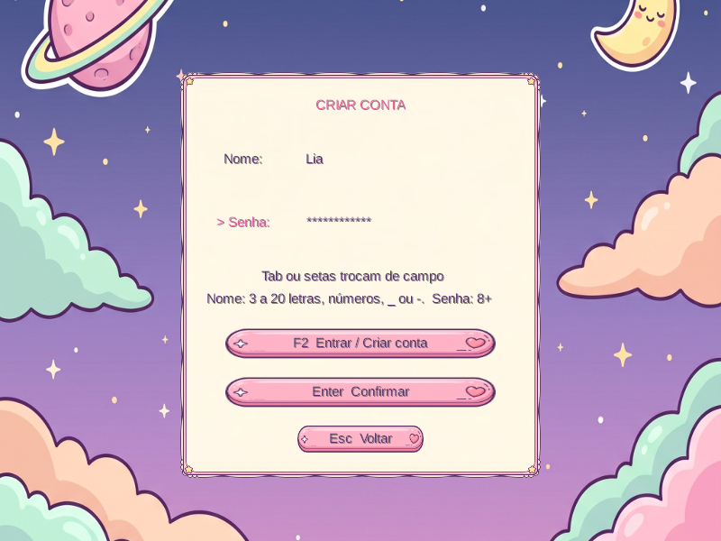

# Fase 5 — Servidor e ranking global

O Missão Marte ganhou um **servidor Spring Boot independente** com cadastro, login (JWT), histórico de partidas e ranking global Top 10. O cliente libGDX (a Fase 4) conversa com ele por API REST, sem travar o desenho.

- **Convidado** (sem entrar): o jogo funciona como na Fase 4, com o ranking local em `ranking.json`.
- **Logado**: vitória **e** derrota vão ao servidor; o menu mostra ranking global e histórico.

|  |  |
|---|---|

## Estrutura

```text
fase-5/
  servidor/   API REST (Spring Boot 4.1.2, Java 17, H2 em arquivo) — build Gradle próprio
    src/main/java/.../servidor/
      api/            controllers, DTOs (records) e tratador de erros (ProblemDetail)
      servico/        regras de conta, partidas e ranking
      persistencia/   entidades JPA, enums e repositórios
      seguranca/      BCrypt, JWT (HS256), regras de acesso, relógio
    requests.http     chamadas de exemplo
  cliente/    o jogo (Fase 4 evoluída) — build Gradle próprio
    core/.../application/servidor/   porta ServidorDoJogo, Sessao, Resposta, PartidaConcluida...
    core/.../gdx/rede/               adaptador HTTP (Gdx.net) e conversão de JSON
    core/.../gdx/                    LoginScreen, HistoricoScreen, RankingScreen, FormularioDeLogin...
  docs/       tutorial e capturas
```

## Requisitos

- **JDK 17** em `JAVA_HOME` e primeiro no `PATH`.
- Internet na primeira execução (wrappers e dependências). Não precisa instalar Gradle nem banco.
- Cliente: OpenGL 2.0+ (áudio opcional).

## Como executar

Dois terminais.

**Terminal 1 — servidor** (porta 8080, só aceita conexões da própria máquina):

```powershell
cd fase-5\servidor
.\gradlew.bat test                      # 21 testes de API
.\gradlew.bat bootRun --console=plain
```

**Terminal 2 — cliente:**

```powershell
cd fase-5\cliente
.\gradlew.bat clean build               # 67 testes, sem rede nem janela
.\gradlew.bat :lwjgl3:run --console=plain
```

Com o servidor desligado o jogo continua no modo convidado e mostra "Não foi possível conectar ao servidor." nas telas online.

### Configuração

| Onde | Opção | Efeito |
|---|---|---|
| Cliente | `-Dmissaomarte.servidor=http://localhost:8080` | Endereço do servidor (padrão: local) |
| Cliente | `-Dmissaomarte.semente=4` / `-Dmissaomarte.semaudio=true` | Como na Fase 4 |
| Servidor | variável `MISSAOMARTE_JWT_SEGREDO` | Segredo do token (mínimo 32 bytes). Sem ela, um segredo aleatório por execução: os tokens deixam de valer ao reiniciar |
| Servidor | variável `MISSAOMARTE_DADOS` | Pasta do banco H2 (padrão `servidor\dados`, ignorada pelo git) |
| Servidor | variáveis `SERVIDOR_ENDERECO` / `SERVIDOR_PORTA` | Padrão `127.0.0.1` / `8080` |

Exemplo (PowerShell), só na sessão atual, sem gravar o segredo em arquivo:

```powershell
$env:MISSAOMARTE_JWT_SEGREDO = "troque-por-um-segredo-longo-e-aleatorio-123"
.\gradlew.bat bootRun --console=plain
```

## Controles

| Tela | Teclas (e clique nos botões) |
|---|---|
| Menu convidado | `1` Jogar, `2` Ranking local, `3` Limpar ranking local, `4` Entrar ou criar conta, `5` Sair |
| Menu logado | `1` Jogar, `2` Ranking global, `3` Meu histórico, `4` Sair da conta, `5` Sair |
| Entrar / Criar conta | digitar, `Tab` ou setas trocam de campo, `F2` alterna entrar/criar, `Enter` confirma, `Esc` volta |
| Nova partida | convidado digita o nome; logado usa o nome da conta. `F1`/`F2`/`F3`, `Enter`, `Esc` |
| Partida | como na Fase 4. Logado, ao terminar: `Enter` só depois do envio; se falhar, `R` reenvia |
| Ranking global e histórico | `R` tenta de novo após erro, `Enter`/`Esc` voltam |
| Qualquer tela sem digitação livre | `M` liga/desliga o som |

## API

| Método e rota | Token | Respostas |
|---|---|---|
| `POST /api/usuarios` | não | 201 `{id, nome}`; 409 nome existe (sem diferenciar caixa); 400 inválido |
| `POST /api/auth/login` | não | 200 `{token, tipo: "Bearer", expiraEm}`; 401 "Usuário ou senha inválidos." |
| `POST /api/partidas` | sim | 201 partida registrada (dono = token; campo `usuario` no corpo é ignorado) |
| `GET /api/partidas/minhas?pagina=0&tamanho=10` | sim | 200 histórico, mais recente primeiro (tamanho 1–50) |
| `GET /api/ranking` | sim | 200 Top 10: a melhor vitória de cada jogador |

Erros saem em `ProblemDetail` (RFC 9457); validação traz `erros: {campo: mensagem}`. Validações: nome 3–20 (`A-Z a-z 0-9 _ -`), senha 8+ caracteres e no máximo 72 bytes, dificuldade `FACIL|MEDIO|DIFICIL`, resultado `VITORIA|DERROTA`, pontuação ±100000, duração 0–86400 s, movimentos 0–100000.

Exemplos prontos em [`servidor/requests.http`](servidor/requests.http).

## Limitações conhecidas

- O servidor **não executa o jogo**: a pontuação vem do cliente e não pode ser provada (só há limites de valores).
- Sem HTTPS: use só em `localhost` ou rede de confiança.
- Sem limite de tentativas de login, sem renovação/revogação de token e sem fila de reenvio: se o envio falhar e o jogador sair da tela, a partida não é gravada.
- Ranking global único (não separado por dificuldade).

Decisões, conceitos, segurança, testes e evidências: [docs/tutorial.md](docs/tutorial.md).
