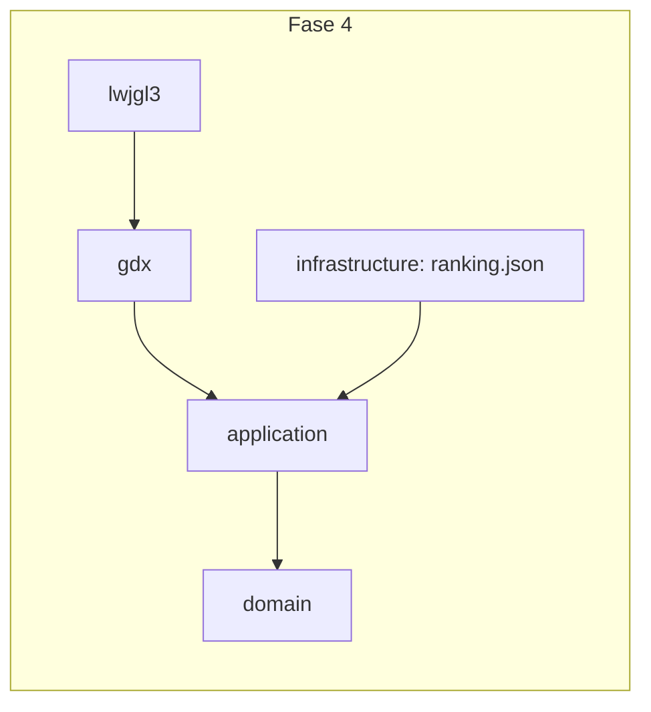
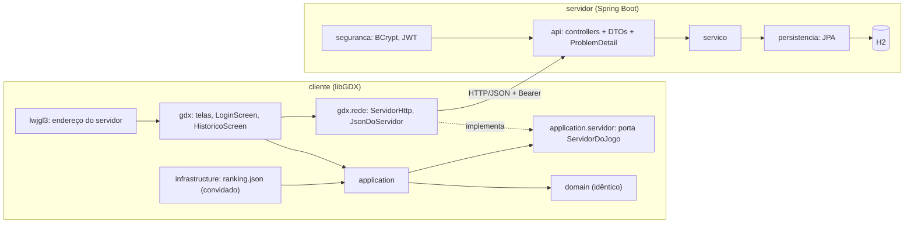

# Fase 5 — Servidor e ranking global

## 1. Estado de origem e destino

Na Fase 4 o ranking era um `ranking.json` na máquina do jogador: sem usuários, editável por qualquer um e diferente em cada computador. Na Fase 5 existe um servidor com contas, histórico e um ranking compartilhado. O modo convidado da Fase 4 continua igual.

| Fase 4 | Fase 5 |
|---|---|
| `ranking.json` local | Banco H2 do servidor (tabelas `usuarios` e `partidas`) |
| Nome digitado a cada partida | Nome da conta (convidado continua digitando) |
| Só a vitória entra no ranking | Logado: vitória e derrota vão para o histórico; o ranking usa a melhor vitória |
| Ranking síncrono (lê o arquivo) | Ranking global assíncrono, com estados carregando/pronto/erro |
| Sem identidade | Cadastro, login com BCrypt e token JWT |
| — | Histórico do jogador (últimas 10) |
| Um build Gradle | Dois builds independentes: `cliente/` e `servidor/` |





O servidor não depende de nenhuma classe do cliente (tem a própria cópia de `Dificuldade`), e no cliente só `gdx` e `lwjgl3` importam `com.badlogic`.

## 2. Conceitos aplicados

**API REST e códigos.** Recursos são rotas (`/api/usuarios`, `/api/partidas`, `/api/ranking`) e a ação é o método HTTP (`POST` cria, `GET` lê). Códigos usados: **200** deu certo e há corpo; **201** algo foi criado (cadastro, partida); **400** pedido inválido (validação, JSON quebrado, enum desconhecido); **401** sem credencial válida (login errado ou token ausente/expirado); **409** conflito com o que existe (nome em uso).

**Camadas do servidor e DTO.** `api` (controllers) só traduz HTTP; `servico` tem as regras (nome único, login, ranking); `persistencia` tem as entidades JPA e os repositórios. Um **DTO** é o formato público de entrada/saída (`Credenciais`, `NovaPartida`, `Respostas.*`, todos `record`). As entidades nunca saem pela API: o hash da senha e o nome normalizado ficam fora do contrato, e o banco pode mudar sem quebrar o cliente.

**JPA e o ranking.** O Hibernate mapeia `Usuario` e `Partida` para tabelas e gera o SQL dos repositórios a partir dos nomes dos métodos (`findByUsuarioIdOrderByJogadaEmDescIdDesc`). O ranking usa uma consulta JPQL que já traz as vitórias com pontuação positiva **na ordem do ranking** (pontuação desc, duração asc, data asc, id asc); `PartidaService.ranking()` percorre essa lista e fica com a primeira partida de cada jogador até 10. É a melhor partida de cada um, porque a primeira que aparece é a melhor pelas mesmas regras. Fica registrado em comentário no código que, com muitos dados, isso deve virar uma subconsulta no banco.

**Hash, sal e custo.** Senha não é criptografada (criptografia se desfaz com a chave; quem tiver a chave lê todas as senhas). Usamos **hash** BCrypt, que não se desfaz: no login comparamos o hash da senha digitada. O BCrypt gera um **sal** aleatório por senha (duas contas com a mesma senha têm hashes diferentes, o que impede tabelas pré-calculadas) e tem **custo** 10 (2¹⁰ rodadas), lento de propósito para frear força bruta. Ele só lê os **72 primeiros bytes**: por isso `@AteBytes(72)` recusa senhas maiores, em vez de cortá-las em silêncio. A OWASP recomenda **Argon2id** para sistemas novos porque, além de lento, ele exige muita memória, o que encarece ataques com GPU; ficamos com o BCrypt por ser o padrão do Spring Security e suficiente para o trabalho.

**JWT e "sem estado".** O token é um JSON assinado (HS256) com `sub` = id do usuário, `nome`, `iat` e `exp` (2 horas). O servidor não guarda sessão: cada requisição traz `Authorization: Bearer ...` e o filtro do resource server confere a **assinatura** e a **expiração** (`JwtDecoder` em `SegurancaConfig`). Sem sessão nem cookie, o navegador não envia credenciais sozinho, então CSRF não se aplica e fica desligado. Se um token vazar, quem o tiver age como o jogador até expirar (não há revogação); por isso a validade é curta e a senha nunca vai no token.

**Validar de novo no servidor.** O `FormularioDeLogin` avisa cedo (nome curto, senha curta), mas qualquer um pode chamar a API sem o jogo (curl, `requests.http`). Só o servidor é confiável: ele valida tudo de novo com Bean Validation.

**Rede assíncrona no libGDX.** `Gdx.net.sendHttpRequest` retorna na hora; a resposta chega depois, em outra thread. Se a tela esperasse, o jogo congelaria. Se o listener mexesse direto nas telas, haveria duas threads alterando o mesmo estado. Em `ServidorHttp`, todo resultado volta por `Gdx.app.postRunnable`, que executa o callback na thread de desenho, no próximo quadro.

**Port and Adapter.** A **porta** é `application.servidor.ServidorDoJogo`: a aplicação diz o que precisa (cadastrar, entrar, enviar partida, ranking, histórico) sem saber como. O **adaptador** é `gdx.rede.ServidorHttp`, que implementa a porta com HTTP. As telas só conhecem a porta; trocar HTTP por outra coisa (ou por um falso nos testes) não muda telas nem regras.

## 3. Decisões e limitações de segurança

| Ameaça | Tratamento |
|---|---|
| Banco vazado | Só hash BCrypt com sal; nenhuma senha em texto |
| Enumeração de usuários | Mesma resposta (status e corpo) para usuário inexistente e senha errada; com nome inexistente, a senha é conferida contra um hash falso para o tempo de resposta ser parecido |
| Token falsificado ou adulterado | Assinatura HS256 conferida em toda rota protegida (teste muda 2 caracteres → 401) |
| Token expirado | `exp` conferido (teste com token emitido 3 h atrás → 401) |
| Gravar partida em nome de outro | Dono vem do `sub` do token; campo `usuario` no corpo é ignorado (testado) |
| JSON malicioso / senha com `"` e `\` | Cliente monta o JSON com `JsonWriter` (escapa); servidor usa Jackson + validação; enum desconhecido → 400 |
| Senha em log | DTOs, `Sessao`, `FormularioDeLogin` e `TokenService.Emitido` escondem segredos no `toString`; o log do servidor rodando foi conferido por busca (nenhuma senha, nenhum `eyJ`) |
| Rotas esquecidas abertas | "Negar por padrão": `anyRequest().authenticated()`; só `POST` de cadastro e login são públicos |
| Exposição na rede | Servidor escuta só em `127.0.0.1` por padrão |

**O que não foi tratado:**
- **Pontuação falsificada.** O servidor não roda o jogo; um cliente modificado (ou um `curl`) pode enviar 99999. A defesa exigiria o servidor reproduzir a partida (receber semente e sequência de ações e recalcular com o mesmo domínio), o que tornaria o servidor dependente das regras do jogo.
- **HTTPS**: token e senha trafegam em texto claro fora de `localhost`.
- **Força bruta no login**: sem limite de tentativas nem bloqueio.
- **Renovação e revogação de token**: sem refresh token nem lista de revogação; sair da conta só apaga o token da memória do cliente.
- **Fila de reenvio offline**: o `R` reenvia enquanto o jogador estiver na tela; saindo dela, a partida se perde.

**Segredo do token em variável de ambiente.** Quem tem o segredo emite token válido para qualquer usuário. No código ou no repositório ele vazaria para todos que leem o Git (inclusive o histórico). Por variável de ambiente, cada máquina tem o seu e nada sensível é versionado. Sem a variável, o servidor gera um segredo aleatório e avisa no log. O segredo de `src/test/resources` só existe para os testes.

## 4. Decisões de projeto

**Dois builds independentes.** Cliente e servidor são aplicativos diferentes, com ciclos e dependências diferentes (libGDX/LWJGL de um lado, Spring Boot do outro). Separados, o servidor não pode importar o cliente por engano, cada um compila e testa sozinho e um problema em um não quebra o outro. Os dois usam o mesmo Gradle 9.7.1 (o Boot 4.1 exige 8.14+), mas cada um tem o seu wrapper.

**Cópia própria do enum de dificuldade.** Compartilhar o enum do cliente criaria a dependência servidor → cliente que a fase proíbe. Para o servidor só os nomes importam (validar e mostrar).

**Modo convidado mantido.** Quem não quer conta (ou está sem servidor) continua jogando como na Fase 4. Custo: as telas de menu, nova partida, fim de partida e ranking têm dois caminhos (`jogo.logado()`), e o fim de partida tem os estados de envio. Ganho: o servidor fora do ar não impede de jogar.

**Callbacks que chegam tarde.** Se o jogador sai da tela antes da resposta, o callback ainda chega. Todas as telas conferem `jogo.getScreen() != this` e ignoram respostas de telas que já saíram.

**Padrões.**
- *Port and Adapter*: `ServidorDoJogo` (porta) e `ServidorHttp` (adaptador), como descrito acima.
- *Repository*: `UsuarioRepository` e `PartidaRepository` (Spring Data) escondem o SQL.
- *DTO*: records da `api`; mais `PartidaConcluida`/`PartidaRegistrada`/`LinhaDoRanking` no cliente.
- *Callback*: `Consumer<Resposta<T>>`; usamos o tipo da biblioteca padrão em vez de criar uma interface só para isso.
- *State* (simplificado): estados de envio/carregamento (`Envio`, `Estado`) decidem o que a tela desenha e quais teclas valem; é um `enum` com `switch`, não classes de estado — parecido com o padrão, não a forma completa.
- *Injeção de dependência*: Spring no servidor (construtores); manual no cliente (launcher cria `ServidorHttp` e passa ao jogo).

## 5. Passo a passo (com os problemas reais)

1. Criamos `fase-5/servidor` com o wrapper da Fase 4 e `build.gradle` com os starters novos do Boot 4 (`spring-boot-starter-webmvc`, não `-web`; testes com `-webmvc-test`). O `MockMvc` precisa de `@AutoConfigureMockMvc` (pacote `org.springframework.boot.webmvc.test.autoconfigure` no Boot 4).
2. Camadas `persistencia` → `servico` → `api`, segurança e os 21 testes. Todos passaram na primeira execução; conferimos que cada classe rodou (8 + 4 + 4 + 5).
3. Subimos o servidor (`bootRun`) e chamamos a API com `curl`. **Problema:** o 401 sem token vinha com corpo vazio (o `HttpStatusEntryPoint` não escreve nada). Trocamos por um ponto de entrada que responde em `ProblemDetail` e acrescentamos a verificação no teste.
4. Copiamos a Fase 4 para `fase-5/cliente`, criamos a porta, os tipos de apoio, `JsonDoServidor`, `ServidorHttp`, o formulário e as telas.
5. Rodamos cliente e servidor juntos com um roteiro de teclas e capturas (semente 4). **Problema:** ao apertar `1`/`4` no menu, o caractere da tecla chegava à tela seguinte depois da troca e entrava no campo de nome. Passamos a ignorar a digitação até a tela desenhar o primeiro quadro (corrigido também na Fase 4).
6. **Problema:** no histórico, o cabeçalho e as linhas eram uma única string com espaços e ficaram desalinhados na fonte proporcional; passamos a desenhar por colunas (`Formatos.colunas`).
7. Derrubamos o servidor durante uma partida logada. **Problema:** a mensagem saiu "O servidor recusou a operação (código -1)": no desktop, conexão recusada chega como `handleHttpResponse` com status -1, não como `failed`. `interpretar` passou a tratar status ≤ 0 como "Não foi possível conectar ao servidor." (teste novo). Religamos o servidor (com o mesmo segredo por variável de ambiente, para o token continuar válido) e o `R` reenviou a partida.

## 6. Testes e evidências

**Servidor** — `.\gradlew.bat test` → **BUILD SUCCESSFUL, 21 testes, 0 falhas** (H2 em memória, segredo de teste, cada teste desfeito ao final).

| Classe | Cobre |
|---|---|
| `ContaApiTest` (8) | 201 sem senha; hash `$2a$10$` diferente da senha; sal (mesma senha, hashes diferentes); 409 com outra caixa; 400 para nome curto/com espaço, senha curta, senha ausente e JSON quebrado; 72 bytes passa e 73 não; login com token/Bearer/expiração e sem senha; mesma resposta para senha errada e usuário inexistente; `toString` sem senha |
| `ProtecaoApiTest` (4) | Sem token 401 (em `ProblemDetail`) inclusive rota inexistente; token inválido e adulterado 401; **token expirado** 401; token válido 200 |
| `PartidaApiTest` (4) | Registro; campo `usuario` ignorado; enum inválido, `ABORTADA`, fora da faixa e campo ausente → 400; histórico só do dono, mais recente primeiro, paginado, `tamanho=51` → 400 |
| `RankingApiTest` (5) | Vazio; uma linha por jogador com a melhor; derrotas e pontuação ≤ 0 fora; desempate por duração e depois antiguidade; limite de 10; sem dados sensíveis |

**Cliente** — `.\gradlew.bat clean build` → **BUILD SUCCESSFUL, 67 testes, 0 falhas** (43 herdados da Fase 4, sem alteração, + 24 novos; nenhum abre janela, usa OpenGL ou rede).

| Classe | Cobre |
|---|---|
| `JsonDoServidorTest` (10) | Credenciais com `a"b\c` continuam JSON válido; números sem aspas, inclusive negativos; token lido e erro se faltar; ranking e histórico, inclusive listas vazias; corpo estranho em 200 vira erro; status -1 vira "não foi possível conectar"; 401 só marca sessão expirada em rota protegida; mensagem por erro de campo, `detail`, 401, 5xx e outros; corpo HTML nunca vaza |
| `FormularioDeLoginTest` (6) | Caracteres aceitos/rejeitados por campo, limites (20 caracteres e 72 bytes), mascaramento, apagar no campo ativo, troca de campo e de modo, validação de entrar e de criar conta, senha fora do `toString` |
| `DadosDoServidorTest` (5) | Partida concluída de vitória e de derrota; erro para partida em andamento ou abortada; `Sessao` sem token no `toString`; os três tipos de `Resposta` |
| `FormatosTest` (3) | Data do histórico no fuso do jogador; rótulos de dificuldade/resultado; linhas do ranking e colunas do histórico |

**Chamadas diretas à API** (servidor rodando, `curl`):

```text
POST /api/usuarios {"nome":"piloto1",...}      201 {"id":1,"nome":"piloto1"}
POST /api/usuarios {"nome":"PILOTO1",...}      409 {"detail":"Este nome já está em uso.",...}
POST /api/usuarios {"nome":"ab",...}           400 {"detail":"Dados inválidos.",...,"erros":{"nome":"Use de 3 a 20 letras, números, _ ou -."}}
POST /api/auth/login (senha errada)            401 {"detail":"Usuário ou senha inválidos.",...}
POST /api/auth/login (correta)                 200 token de 176 caracteres
GET  /api/ranking (sem token)                  401
POST /api/partidas                             201 {"id":1,"dificuldade":"FACIL","resultado":"VITORIA","pontuacao":47,...}
GET  /api/partidas/minhas                      200 [ ...1 partida... ]
GET  /api/ranking                              200 [{"posicao":1,"nome":"piloto1","pontuacao":47,...}]
```

Busca no log do servidor por `senha-de-teste` e `eyJ` (início de todo JWT): **0 ocorrências**.

**Capturas** (cliente + servidor rodando, semente 4): [menu convidado](capturas/01-menu-convidado.png), [criar conta com senha mascarada](capturas/02-criar-conta.png), [menu logado](capturas/03-menu-logado.png), [nova partida logado](capturas/04-nova-partida-logado.png), [resultado enviado](capturas/06-resultado-enviado.png), [ranking global com "Você está no Top 10!"](capturas/07-ranking-global.png), [histórico](capturas/08-historico.png), [saiu da conta](capturas/09-saiu-da-conta.png), [senha errada](capturas/10-senha-errada.png), [falha de envio com R](capturas/11-falha-envio.png), [reenviado após religar](capturas/12-reenviado.png), [ranking sem servidor](capturas/13-ranking-sem-servidor.png), [entrar sem servidor](capturas/14-login-sem-servidor.png).

**Comparação por hash com a Fase 4:** `domain`, `application` (exceto o pacote novo `application/servidor`) e `infrastructure` são idênticos. Em `gdx` mudaram `MissaoMarteGame` (sessão e porta), `MenuScreen` (dois modos), `NovaPartidaScreen` (nome da conta), `PartidaScreen` (envio), `RankingScreen` (global assíncrono) e `HudRenderer` (aviso do envio na caixa de fim). Novos: `LoginScreen`, `HistoricoScreen`, `FormularioDeLogin`, `Formatos`, `rede/ServidorHttp`, `rede/JsonDoServidor`. Nenhum `com.badlogic` fora de `gdx`/`lwjgl3`.

**Não verificado:** sessão expirada (401) pela interface — a regra está coberta por teste (`naoAutorizado` só em rota protegida) e as telas chamam `sessaoExpirada`, mas não esperamos 2 h nem forçamos um token vencido no jogo.

## 7. Comparação com a implementação do professor

| Tema | Professor | Grupo 07 | Decisão |
|---|---|---|---|
| Organização do servidor | Por funcionalidade (`usuario/`, `auth/`, `partida/`, `ranking/`) | Por camada (`api/`, `servico/`, `persistencia/`, `seguranca/`) | Deixa a regra de dependência visível; por funcionalidade escala melhor em sistemas grandes |
| Ranking | Subconsulta JPQL "melhor partida por jogador" | Consulta ordenada + primeira de cada jogador no serviço | Mais simples de ler e testar; mais lento com muitos dados (marcado no código) |
| Limite de 72 bytes | Validação equivalente | Anotação própria `@AteBytes` | Mensagem no campo `senha` do `ProblemDetail` |
| 401 sem token | — | `ProblemDetail` também no 401 | Cliente e humanos recebem o mesmo formato em todos os erros |
| Callback | Interface própria | `Consumer<Resposta<T>>` | Menos tipos; mesmo papel |
| Swagger UI | Opcional, incluído | Não incluído | `requests.http` cobre o teste manual |
| Testes | 34 (servidor) e 97 (cliente) | 21 e 67 | Cobrem todos os itens pedidos, com menos casos por item |

## 8. Limitações e próximos passos

1. **HTTP em texto claro e permissão `INTERNET`** — na Fase 6 (Android) o app precisará da permissão e de `usesCleartextTraffic` (ou HTTPS) para falar com o servidor; e `localhost` no celular é o próprio celular, então o endereço configurável (`missaomarte.servidor`) passa a ser essencial.
2. **Fila de reenvio offline** — guardar partidas não enviadas e reenviar ao voltar a conexão; útil no celular (Fase 6), onde a rede cai mais.
3. **Ranking por dificuldade** — hoje Fácil e Difícil disputam a mesma tabela; um filtro `?dificuldade=` seria uma evolução natural (candidata à Fase 7).
4. **Validação da pontuação** — enviar semente + ações e reproduzir a partida no servidor (Fase 7, se houver tempo), reaproveitando o domínio como biblioteca.
5. **Renovação de token e limite de tentativas** — refresh token curto e bloqueio temporário após falhas seguidas.
6. **Teclado na tela de login** — os campos ainda não são clicáveis; no Android (Fase 6) será preciso abrir o teclado virtual ao tocar no campo.
